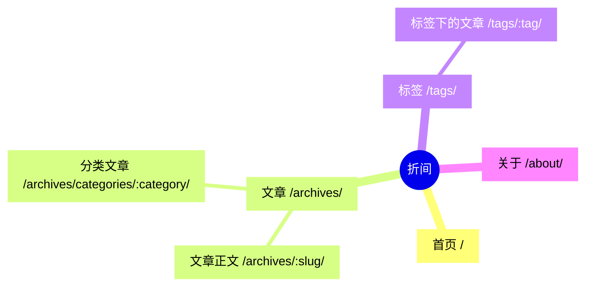

# 折间 · 页面层级

下图是可直接修改的 Mermaid 思维导图。根节点下面一层对应顶栏入口，每个子节点归属最近的一级栏目。要调整网站结构，可以直接增删节点、修改路径，或通过缩进移动节点。

路径中的 `:slug` 是文章文件名，`:category` 和 `:tag` 分别取文章中的分类名和标签名。部署到子目录时，图中的路径统一加上部署前缀。

| 页面 | 内容与去向 |
| --- | --- |
| 首页 | 最新手记、近期文章和分类入口。点封面或文章标题进入文章正文。 |
| 文章 | 全部手记按日期从新到旧排列。点标题读正文，点侧栏分类看该分类的文章。 |
| 文章正文 | 目录定位到本页标题，文末可读相邻文章或打开标签。每篇正文只有一个正式地址。 |
| 分类文章 | 一个分类一页，列出该分类下的文章。目前有「折纸手记」「散步笔记」「设计与代码」。 |
| 标签 | 展示全部标签及篇数。点标签进入对应的文章列表。 |
| 标签下的文章 | 展示拥有该标签的文章。点标题进入「文章」栏目下的同一篇正文。 |
| 关于 | 手记与站点介绍。 |

**辅助地址。** 找不到页面时显示 `404.html`，顶栏没有选中项。`/credits.txt` 提供素材署名。旧书签 `/posts/:slug/` 和 `/categories/:category/` 分别跳转到图中的正文和分类页。

新增一级栏目时，在栏目配置中登记名称、路径和图标。调整子页面时，同步修改页面文件与链接生成函数。[栏目配置](../src/lib/sections.ts) · [页面目录](../src/pages/) · [内容链接](../src/lib/blog.ts)
