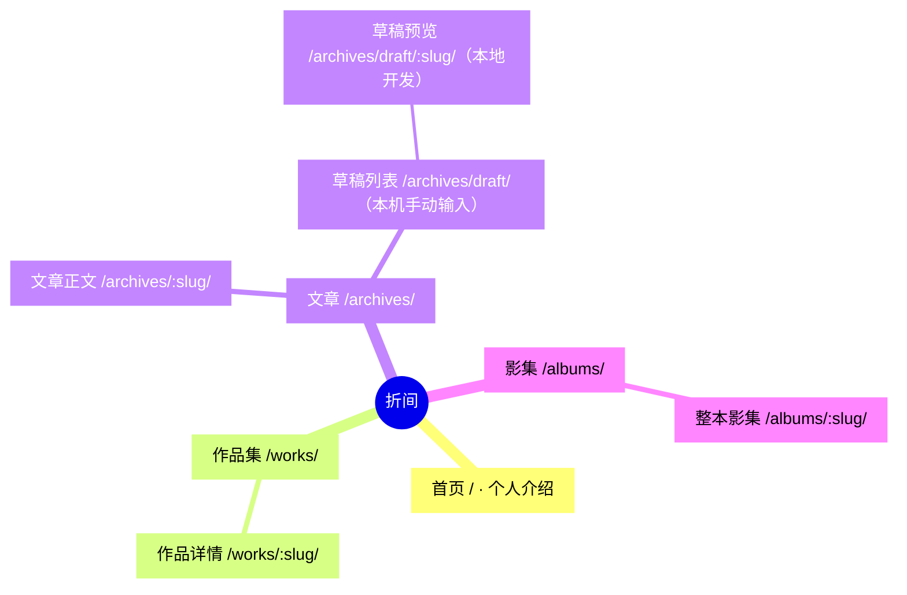
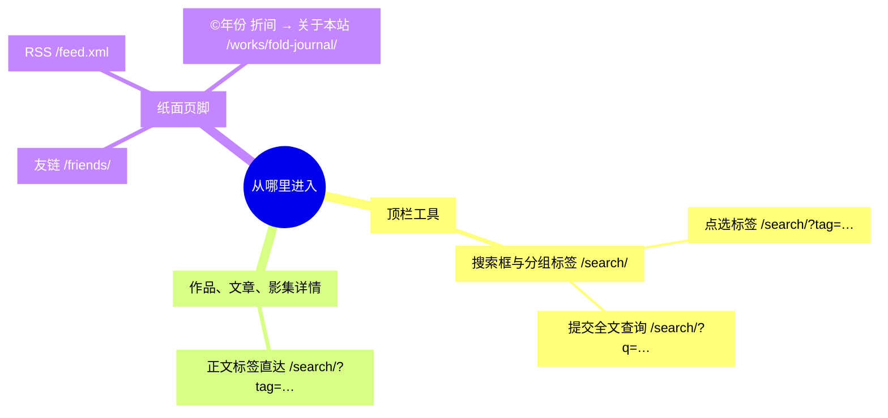

# 折间 · 页面层级

四个一级栏目共用一张纸面，作者的个人资料集中在首页。首页、栏目列表、搜索和友链直接展示内容或操作。打开具体内容时，纸面显示文章篇名、作品名或影集名。下图标出公开页面、开发模式下的文章草稿以及各入口的归属。[栏目配置](../src/lib/sections.ts) · [页面目录](../src/pages/)

## 四个一级栏目

这张 Mermaid 思维导图可以直接编辑。根节点的四个分支按顶栏顺序排列。子页继承所属栏目，标为「本地开发」的分支仅在本机开发时出现。

| 栏目 | 访客如何浏览 |
| --- | --- |
| 首页 | 直接阅读「关于我」的正文，依次是自我介绍、经历、代表项目和联系方式。「折间」是段落中通向作品详情的文字链接。经历与邮箱留空时仍显示占位文字。`/#contact` 定位到「联系方式」。 |
| 作品集 | 总览直接列出作品。一个项目或一件独立作品各有一个详情页，可以展示成品、作者的职责和创作过程。每件作品可以有多个标签，从任一标签找到的都是同一页。 |
| 文章 | 列表按发布日期从新到旧排列。正文有可定位到段落的目录、全站标签，以及按发布时间排列的相邻文章。首版用时间和标签组织公开文章。 |
| 影集 | 总览以封面展示各本影集。新打开或分享一本影集，都从该册封面开始，随后按作者编排的顺序看照片。标题、标签、分享地址和订阅条目都属于整本影集。 |

作品、文章和影集各自有稳定的 `:slug`。从首页、标签或搜索打开同一件作品，都使用它的正式地址。例如摄影书的装帧过程可以放在作品页，整组照片放在影集，两页用相关链接互相引导。部署到子目录时，所有站内地址统一加上部署前缀。

## 主导航之外的入口

| 入口 | 地址 | 从哪里进入，打开后去哪里 |
| --- | --- | --- |
| 搜索与标签索引 | `/search/` | 从顶栏进入，搜索框下按主题列出全部公开标签和内容数。输入文字即时筛选标签名和组名，`?filter=…` 保留筛选词。初始分组为设计与创作、编程与算法、研究与论文、校园与日常，新标签默认归入「其他」。[分组配置](../src/data/tag-groups.json) |
| 标签匹配 | `/search/?tag=…` | 点搜索页或正文里的标签，查看所有使用该标签的作品、文章和影集。结果中显示所选标签和命中数量，每项直达内容详情。 |
| 全文检索 | `/search/?q=…` | 提交关键词后，在同一页查看标题、摘要、标签或正文命中的内容。空格分开的关键词须全部命中，结果按内容类型分组。「全部标签」回到搜索首页。 |
| 友链 | `/friends/` | 只有一组站点时直接展示卡片。「我的朋友」和「我常读的网站」都有内容时，用小字组名区分两组。作者公开邮箱后，「联系我」链接到首页的邮箱，可接收读者来信和友链申请。 |
| 关于本站 | `/works/fold-journal/` | 点击页脚的「©年份 折间」打开作品集里的「折间」项目。这里讲本站的设计、纸纹和折纸换页，以及纸鹤折痕的来历，读者可以继续查看 `/credits.txt` 的完整署名。 |
| 订阅更新 | `/feed.xml` | 页脚提供一份全站 RSS，供读者用阅读器订阅。每件新作品、每篇新文章、每本新影集各占一条，链接回本站的正式页面。 |

### 友链卡片

每张卡片先给出站名、原站地址和一句推荐，再给出两个阅读入口。

- **我推荐的文章**由作者手动挑选和维护，链接到对方站上最值得从头读的文章。
- **最新发布**取对方 RSS 或 Atom 订阅源最近发表的一篇，显示标题、原文发布日期并直达原文。读取失败时沿用上次成功同步的条目，对方未提供订阅源时可以手动填写。

## 文章草稿与旧书签

本机运行 `astro dev` 时，作者可手动输入 `/archives/draft/` 选择草稿，或输入 `/archives/draft/:slug/` 直达预览。也可直接阅读 `src/content/posts/draft/` 中的 Markdown。`draft` 是该分区预留的路径段。草稿区收录六篇折间示例与旧博客的两份草稿。「折纸手记」「散步笔记」「设计与代码」随示例留作草稿资料。

公开构建只生成已发布内容。文章列表、相邻文章、首页引用、标签及其计数、搜索索引、RSS 和旧地址跳转均遵循这个范围。生产预览与正式站直接访问草稿列表或预览地址都返回 404。

| 已有地址 | 当前去向 |
| --- | --- |
| `/posts/:slug/` | 有已发布的对应文章时跳转到 `/archives/:slug/`。仅对应本地草稿的旧书签在公开站返回 404。 |
| `/年/月/日/:slug/`、`/links/` | 旧 Hexo 博客八篇文章的日期书签转到相应正文，原友链页转到 `/friends/`。 |
| `/archives/:slug/` | 已发布文章的正式地址。六篇示例的原公开正文地址返回 404。 |
| `/categories/:category/`、`/archives/categories/:category/` | 原先三个示例分类随样稿进入草稿区，旧分类地址在公开站返回 404。 |
| `/tags/`、`/tags/:tag/` | 原独立标签页已移除，旧地址返回 404。标签书签使用搜索页地址，例如 `/search/?tag=C%2B%2B`。 |

## 页面归属与折纸

- **跨一级栏目**时收纸、展纸。例如从首页点代表项目，由「首页」收纸，到「作品集」展纸。页脚版权链接也按它的目标栏目「作品集」判断。
- **同一栏目内**直接切换内容。作品列表到作品详情、文章到相邻文章、影集列表到整本影集都沿用当前栏目的图标。目录锚点在当前纸面内定位。浏览器前进和后退按相同的栏目规则换页，并恢复对应历史条目的纸内位置。
- **搜索、友链和 404** 都是辅助页面，顶栏四项均无选中态。涉及这些页面的站内跳转直接切换内容。找不到页面时使用 `404.html`，保留「返回首页」与「全部文章」入口。`/feed.xml` 和 `/credits.txt` 作为独立资源提供。
- **栏目选中态**沿用 `FoldDock`。一级页使用 `aria-current="page"`，子页在所属入口使用 `aria-current="location"`。选择减少动态效果时，跨栏目也直接显示目标页面。

调整页面结构时，同步维护 README、一级栏目配置、内容链接和 VI 中的导航说明。页面通过 `Site` 共用桌面、纸面、顶栏与版权区。[README](../README.md) · [栏目配置](../src/lib/sections.ts) · [内容链接](../src/lib/blog.ts) · [项目 VI](vi-design.md#导航线稿与停靠) · [协作约定](../AGENTS.md)
