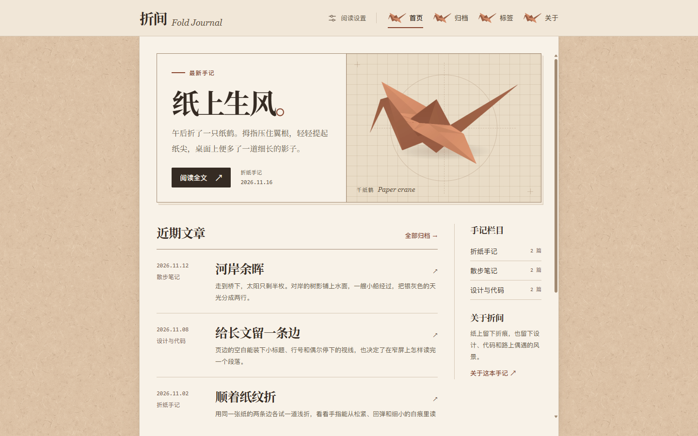
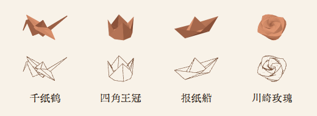

# 折间 · 视觉识别与组件规范

折间收录作者的作品、文章和摄影集。桌面托住纸张，正文、插图和版权排在同一张纸上。字号、线条和留白区分阅读层次，换页时的纸鹤指向内容所属栏目。

颜色、字体、字重和尺寸以 [CSS 设计变量](../src/styles/tokens.css) 为准。页面从 [Astro 组件库](../src/components/ui/index.ts) 取用界面。本文参考了 [PebblePile 的 VI 说明](https://github.com/155TuT/PebblePile/blob/main/docs/vi-design.md) 将视觉角色、对应组件和验证方法放在一起的做法。



## 标志与插图

站标由中文「折间」和斜体英文 *Fold Journal* 组成，两者的可见字底对齐。桌面字号分别为 30 和 18 px，双行顶栏中缩为 24 和 15 px。视口宽度不超过 355 px 时英文站标缩为 12 px，以便放下搜索与设置。站标左边与纸张外沿对齐，点击回到首页。

主导航的五个入口依次是「首页、作品集、文章、影集、关于我」。常规布局将图标置于文字左侧。当前栏目使用折纸线稿、墨色文字与一条 2 px 的赤陶色下划线。作品、文章和影集详情各自继承栏目。搜索位于顶栏工具区，全站标签、搜索、友链和 404 使用无选中态。[页面层级思维导图](page-map.md)

插图使用细方格、定位十字和有替代文本的图像。正文图版可附中英文图注，首页封面仅展示纸鹤。封面图与标题并排时用竖线分隔，单栏时改用横线。文章内插图四边有细框。纸鹤与河岸两幅图均使用静态资源。[插图组件](../src/components/ui/Plate.astro)

### 导航线稿与停靠

线稿表现读者从正面能看见的纸边与折边。以千纸鹤为例，外缘勾出喙、双翼和尾尖，内部折线交代颈部与身体的交界、翼根和翼面。被上层纸面盖住的线段在遮挡处截断，共面的三角剖分线省去。原稿画框为 39 × 32，线宽取 `--dock-outline-stroke`（0.65 px）。浅色使用细棕线，深色使用浅棕线。



| 状态 | 导航与纸面的表现 |
| --- | --- |
| 停留在某个页面 | 每个入口底层常驻一份线稿。当前栏目露出线稿，其他栏目在线稿上覆盖实心图。一级页使用 `aria-current="page"`，子页在其所属栏目上使用 `aria-current="location"`。 |
| 跨栏目收纸 | 纸面折成当前栏目的实心图，平移到该入口的线稿上。实心图、线稿和飞行末帧共用画框、透明边距和中心点。 |
| 抵达与等待 | 飞行图抵达线稿后由同尺寸的导航实心图接替。等待目标文档期间保持停靠姿态。 |
| 新栏目展纸 | 从新栏目入口的实心图起飞展开，露出下方的线稿。原栏目此时显示实心图。 |
| 同栏目、减少动态效果或无脚本阅读 | 目标页直接呈现栏目选中态。栏目子页继承所属图标，辅助页面展示五个实心图。 |

每个一级栏目在配置中分别提供实心图 `icon` 和透明线稿 `outline`。两张图按同一最终折姿、相机与画框输出。组件把 SVG 作为遮罩，线色由主题变量控制。五个入口目前复用同一只纸鹤，浏览器共用一个线稿资源。以后更换造型时，从对应模型的停靠姿态出图，并让该栏目的折叠动画使用相同姿态。[栏目配置](../src/lib/sections.ts) · [FoldDock 组件](../src/components/ui/FoldDock.astro)

**线稿在制作素材时预烘焙。** 通用工具接收投影后的顶点、从后向前排列的三角面和物理纸边，按遮挡裁剪后输出 SVG。纸鹤导出器读取 FOLD 的边界、山折、谷折与剪切边，使用与实心图相同的末帧。修改纸色、线宽或造型后运行 `node tools/render-crane.cjs`。其他折纸模型可以复用同一套可见边提取逻辑。[可见边提取](../tools/fold-outline.mjs) · [纸鹤导出器](../tools/render-crane.cjs)

本机 Chrome 157 上，同一只 112 面纸鹤首次投影、裁剪并编码约 1.7 ms，后续 40 次采样中位数 0.3 ms，P95 为 0.7 ms。输出文件 2,277 字节。另取 40 个新的本地 SVG 图像分别解码、绘制并读回像素，中位数 1.3 ms，P95 为 2.3 ms。两项分别测量生成和显示，均排除网络等待。预烘焙省去读者端加载模型与生成线稿的开销，显示成本仍在。首次访问请求一份静态文件，之后可按站点的 HTTP 缓存策略复用，切换主题仅改变线色。用 `node tools/render-crane.cjs --benchmark` 可复测耗时，`node --test tools/fold-outline.test.mjs` 可检查内折边与局部遮挡。

## 配色与表面

桌面用带杂纤的原浆纸色，中央内容纸面用更浅的暖白，正文用浓褐墨色。赤陶色用于纸鹤、栏目下划线和文字链接。深色主题把桌面压到深褐，正文用暖白，链接转为浅陶色。

| 设计变量 | 浅色 | 深色 | 用途 |
| --- | --- | --- | --- |
| `--bg-surface` | `#DBC1A5` | `#302821` | 再生纸桌面的纸浆底色 |
| `--bg-strong-fiber` | `#94765B` | `#201912` | 掺入纸浆的深色短纤维 |
| `--bg-lite-fiber` | `#F5E4CC` | `#715F4E` | 浅色纤维及细颗粒 |
| `--base` | `#F1E7D8` | `#2A231E` | 不透明顶栏、封面叠纸边 |
| `--surface` | `#F8F2E8` | `#372E28` | 内容纸面、弹层、标签底色和展开时的平纸 |
| `--ink` | `#352B23` | `#F1E7D9` | 正文、标题、主操作底色 |
| `--muted` | `#655444` | `#CBB9A5` | 摘要、图注、未选导航、版权与备案 |
| `--faint` | `#75604E` | `#BBA58F` | 日期、篇数、目录编号 |
| `--accent` | `#874630` | `#E6AE91` | 链接、当前栏目下划线、焦点、打开的开关 |
| `--accent-ink` | `#FFF4E7` | `#3F241A` | 强调色底上的文字或开关圆点 |
| `--dock-outline-ink` | `#785139` | `#D1AB86` | 顶栏折纸线稿的纸边与可见折边 |
| `--line` | `#D6C8B5` | `#58493D` | 列表行、侧栏与版权分隔线 |
| `--line-dark` | `#A18A72` | `#8B7461` | 标题分隔线、封面边界、滚动条 |
| `--plate` | `#E9DCC7` | `#473A30` | 插图底色，网格与标线取 `--plot-grid`、`--plot-line` |
| `--wash` | `#EDE2D1` | `#41352B` | 行内代码与关闭状态的开关 |
| `--crane-paper` / `--crane-shadow` | `#DF9671` / `#643321` | 同浅色 | 纸鹤受光面与背光面，静态插图和折叠模型共用 |
| `--fold-shadow` | `#90745A` | `#1C1612` | 内容纸刚抬起时的折面阴影 |

纸边和列表使用 1 px 实线。封面的错位纸边用 `--shadow-cover`，中央纸张用 `--shadow-sheet`，浮起的阅读设置用 `--shadow-panel`。主操作圆角 2 px，设置面板为 4 px。正文页通过标题、细线和空白分区。

根元素的 `data-theme` 切换整套配色。收纸时，折面从当前主题的 `--surface` 逐渐过渡到纸鹤的赤陶色，展开时沿原路径回到纸色。Canvas 2D 和 WebGL2 共用两端的颜色。横线、方格、折痕和高光分别使用 `--fold-rule`、`--fold-grid`、`--fold-score`、`--fold-highlight`。[纸张材质与模型](../src/lib/fold/paper.js)

### 再生纸纹与透明纹样

每块 384 × 384 px 的纸纹混合了 850 条深色短纤维、1,570 条浅色纤维与细颗粒噪声。纤维方向随机，穿过边缘的纤维从对边接续。大尺度色差保持轻微，使整张纸的颜色均匀，近看仍能辨出纸浆中夹杂的短纤维。种子 73421 使浏览器与静态后备图能复现同一张纸。[纸纹生成与缓存](../src/scripts/desk-texture.cjs)

首次打开且缺少有效缓存时，浏览器生成深浅两张透明度位图，并将两张 PNG 和配方版本一起存入 `localStorage` 的 `fold-journal:desk-texture`。刷新或直接打开文章时，文档头部在解析正文之前同步读取缓存，为首帧提供同一张纸纹。站内换页保留桌面节点和承载纹理的样式表。明暗主题共用两张遮罩，由 CSS 变量实时着色。

本地存储不可写时优先使用标签页的 `sessionStorage`。没有可读存储、禁用 JavaScript 或画布不可用且缺少缓存时，桌面使用同一配方导出的静态 WebP。调整纤维密度或噪声后，更新生成器的配方版本，运行 `python tools/generate-paper.py` 导出后备图，并更新本页样张。[后备图导出工具](../tools/generate-paper.py)

图层从下往上依次为桌面底色、深纤维、浅纤维和透明纹样，纸面与顶栏位于纹样上方。默认只显示纸质。接入竹林等透明图时，在构建环境中设置 `PUBLIC_DESK_IMAGE_URL`，例如素材存为 `public/art/bamboo.webp` 时填 `art/bamboo.webp`。也可以在主题中设置 `--bg-overlay-image`。浮层默认居中铺满，不透明度为 35%。下例将小幅纹样调整为 320 px 宽，降低浓度后重复铺排。[桌面组件](../src/components/ui/DeskBackdrop.astro)

```css
:root {
  --bg-overlay-size: 320px auto;
  --bg-overlay-repeat: repeat;
  --bg-overlay-opacity: .18;
}
```

## 字体与字重

| 文字角色 | 字体变量 | 字号、字重与行高 |
| --- | --- | --- |
| 封面标题 | `--serif` | 29–78 px，700，行高 1.12 |
| 内页与文章标题 | `--serif` | 28–59 px，700，行高 1.2 |
| 栏目标题、文章列表标题 | `--serif` | 栏目 26 px、列表 20–26 px，650。单栏分别为 23、21 px |
| 正文与正文小标题 | `--serif` | 正文 17 px，单栏 16 px，400，行高 1.95。二、三级标题为 25、21 px，700 |
| 导航、操作与说明 | `--sans` | 常规 400，导航和文字链接 550，主操作和眉题 600。说明与操作常用 12–14 px |
| 日期、篇数与代码 | `--mono` | 日期 12 px 并使用等宽数字，篇数 11 px，代码块 13 px |
| 英文站标、图注英文 | `--latin-serif` | Georgia 斜体。英文图注 14 px |

中文标题与正文优先 Noto Serif SC，依次回退到宋体类字体。界面使用 DM Sans 配系统中文无衬线字体，日期和代码优先 IBM Plex Mono。站点使用读者设备上可用的字形。以上字重对应 `--weight-regular / medium / semibold / heading / bold`，新增角色在设计变量里命名。

## 纸面、版心与版权

- **纸面外框**宽 `60vw`，水平居中。上沿贴合不透明顶栏底边，下沿贴合视口底边。顶栏通常高 75 px，视口宽度不超过 1200 px 时分两行，高 88 px。宽度不超过 700 px 时，第二行分为五个等宽入口。图标居中放在文字上方，整行对齐纸面两边，停靠点始终可见。
- **版心四边**共用 `--paper-inset`，随视口取 `clamp(10px, 2.4vw, 48px)`，支持 CSS 取整的浏览器按整像素对齐。1440 px 宽时四边为 35 px，390 px 宽时为 10 px。上下留白位于正文与版权共用的容器内，随内容卷入、卷出。滚到开头可见正文上方的留白，滚到末尾可见版权下方的留白。
- **滚动区**是整张 `main#content`。原生滚动条贴右侧纸边，轨道从顶栏底部一直到视口底部。阅读中段的内容可以到达纸面的上下边缘。目录跳转使用同一间距将目标段落留在易读的位置。[纸面组件](../src/components/ui/Paper.astro)
- **纸内排版**以 4、8、12、16、20、24、32 px 为常用间距。首页封面与栏目入口、正文与版权之间使用 `--section-gap`。视口宽度不超过 1084 px 时主栏、侧栏和封面插图依次纵向排列，文章目录随内容排在后面。超出正文或列表项宽度的公式、表格和代码可在各自容器内横向滚动。
- **版权区**通过一条细线与正文分隔。左侧「友链　RSS　©年份 折间」始终同排，版权文字链接到「关于本站」。备案靠右，纸面较窄时整组移到下一行，并可在两个备案项之间折行。短页靠近纸面下边，长页随正文滚到末尾出现。正式备案信息统一在 [PaperFooter](../src/components/ui/PaperFooter.astro) 更新。


## 组件选用

使用组件的字号、留白、分组和细线表达层级。页名直接作一级标题，按钮文字只写动作或目的地。内容本身的介绍、图注、搜索反馈和空列表状态按需要出现。

组件通过 `src/components/ui/index.ts` 导出。页面负责取数和组合组件，布局根据 URL 确定所属栏目。组件的样式、变体和断点放在对应的 `.astro` 文件中。

| 用途 | 组件 | 用法 |
| --- | --- | --- |
| 站点外框 | `DeskBackdrop`、`SiteHeader`、`Paper`、`FoldStage` | 由 `Site` 统一装配。页面可传纸纹 `ruling`，纸面自带 `PaperFooter`。辅助页使用无选中态，404 显式使用 `current={null}` |
| 折纸导航图标 | `FoldDock` | 接收栏目配置中的实心图和线稿，提供播放器测量的停靠框。选中、停靠与主题状态由顶栏和布局驱动 |
| 阅读偏好 | `ReadingSettings`、`SettingSwitch` | 使用原生展开面板与带标签的开关。设置项沿用 `theme`、`reduce`、`parallel` |
| 分栏与旁注 | `ContentColumns`、`Sidebar`、`TableOfContents` | 正文进默认插槽，侧栏进 `aside` 插槽。文章传 Markdown 标题生成二、三级目录 |
| 标题 | `PageHeading`、`SectionHeading` | 内页直接显示页名，分区标题可附文字操作 |
| 链接与操作 | `ActionLink`、`ActionRow` | 普通文字链接使用默认变体，主要阅读入口使用 `variant="primary"`。可选箭头属于装饰，操作含义由可见文字给出 |
| 封面、插图与日期 | `IntroCover`、`Plate`、`PostDate` | 首页封面承载作者介绍与简历入口。插图支持 `cover`、`article` 两种变体。日期用 `time` 元素同时保留标准值与印刷格式 |
| 文章与索引 | `PostList`、`PostArticle`、`Prose`、`TagList`、`PostNeighbors` | 作品、文章和主题结果共用列表。文章把 Markdown 正文传给 `PostArticle`，自定义长文可用 `Prose`。索引标签带内容项数，文末标签用紧凑的 `article` 变体 |
| 栏目入口与影集照片 | `SectionLinks`、`AlbumPhoto` | 首页入口平级排列，窄屏依次纵排。影集按作者给定的顺序逐张展示 |
| 查询与友链 | `ContentGroups`、`SiteSearch`、`FriendCard` | 标签结果和搜索结果按作品、文章、影集分组。友链标题旁可配原站头像，作者荐读与对方的新文章仅在有资料时呈现 |

## 动效、键盘与验证

折纸以整张可见纸面的外框为起点。仅当起点与终点属于不同的一级栏目时收展，收纸与展纸各 1160 ms。正文和版权跟随平纸淡出与恢复。从作品集点进项目、从文章读相邻文章、从影集目录打开一册，以及涉及辅助页面的跳转，都直接换内容。返回与前进遵循同一规则，并按历史条目恢复纸内位置。选择「减少动态效果」后，跨栏目也直接换页。[换页逻辑](../src/scripts/navigation.ts) · [折叠播放器](../src/lib/fold/player.ts) · [滚动恢复](../src/scripts/paper-scroll.ts)

用 Tab 可以进入「跳到正文」、导航、设置和纸面。键盘焦点使用 2 px 强调色轮廓。正文链接带下划线，导航以文字和下划线标出当前栏目，开关通过圆点位置与选中状态表达变化。文章、目录、版权和普通链接都随静态 HTML 输出。

修改版心或组件后，运行 `npm run check` 和 `npm run build`。在生产预览中运行 [导航回归](../tools/check-navigation.cjs)，检查四边距离、长短页版权位置、导航收展、目录锚点与历史恢复。

桌面保留浏览器原生滚动条。明暗样张取自 1440 × 900 的生产页面。窄屏通过 390 × 844 和 320 × 568 的浏览器视口验证。

纸纹回归使用独立的浏览器上下文。首次访问检查两张遮罩已生成并写入存储，刷新及站内翻页检查生成次数为零，并核对两层桌面纹理确实取自缓存。布局回归同时测量纸面外缘、完整滚动高度、正文首行和版权末行的间距。
