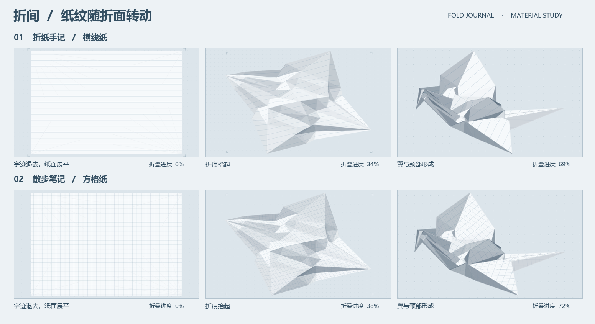

# 折间 · 从一张笔记纸到六个折纸入口

> 本文记录最初的双页实验及其当时的测量。当前博客的路由、运行方法和阅读设置见[项目首页](../README.md)。

从项目根目录启动静态服务器后可打开 `/prototype/`。点「0.5× 慢放」，从「折纸手记」切到「散步笔记」，看旧纸的横线怎样绕过折痕，再看新纸的方格怎样从纸翼上铺回整页。[可运行页面](../prototype/index.html)

**当前播放器用 Canvas 2D 建立基线，在同一台设备上实测 WebGL2，再选择后续的折面绘制方式。** 两种后端共用姿态和纸纹。六个入口共用纸鹤，只需要一份折叠数据。如果六个栏目分别用鹤、船等不同造型，增加的是五份经过校验的模型资产，以及一层按栏目选模型的代码。单次换页的峰值绘制量主要由其中较复杂的那只折纸决定。[后端选择、实际跑分与框架接入](渲染回退与博客集成.md)

## 1. 现在看到的是哪几层

| 层 | 阅读状态 | 换页状态 | 修改位置 |
| --- | --- | --- | --- |
| 桌面和导航 | 冷灰蓝桌面 `#dce5eb`，纸白 `#f6f9fb`，墨色 `#243440`。两只鹤共用银灰纸材，选中状态由按钮底色、描边和占位透明度表达 | 导航自身留在原处，飞行的那只暂时隐藏原图标 | `journal.css`、`index.html` |
| 字迹和插图 | 可选择、可聚焦的 HTML，加两幅静态 Canvas 插图 | 平纸阶段直接缩放原文章，逐渐降低正文和插图的不透明度。起折时字迹已退尽，展开末段再显示真正的文章 | `journal.js` 的 `showFlat` 与 `journal.css` 中的 `.flat-motion` |
| 纸张 | 横线或方格铺满一整张纸，另印上 18 段山折、谷折留下的浅压痕 | 同一张底纹按每个折面投影，背面更淡，纸翼缩小后细线逐步退去 | `paper.js` 的 `stockStyles`、`drawStock`、`drawMesh`，以及 `fold-renderer.js` 的片元着色器 |
| 形状和视角 | 导航里的鹤和第一页大插图都取自相同的终态顶点 | 64 个共享顶点、112 个三角面、33 个采样姿态。由正视纸面过渡到水平偏转约 −30°、从水平面上方约 30° 俯看的机位，另有模型朝向校正 | `crane-data.js`、`paper.js` 的 `view` 与 `project` |

桌面纸页沿显示区域的中线居中，宽度为视口的 56%，760 CSS px 及以下为 60%。高度由排版决定。折痕原稿是一张正方形，阅读时水平方向与垂直方向分别适配纸页，收成鹤时平滑回到模型自身的等比尺寸。超窄屏仍保留两侧留白，文章改用单栏。



图取自浏览器的实际切换帧。上排截取收起，下排截取展开后按折叠进度排列。各格按纸的包围框单独取景，便于看线条。实际相对大小、速度和导航距离见录像。

## 2. 把求解留在制作阶段

**折痕图**记录纸上哪些位置可以弯、弯向哪边。**姿态**记录某个折叠进度下每个顶点在三维空间中的位置。**打包**把选定的姿态压缩成网页能直接读的数据。这三步可以独立返工。

1. 本项目的平面原稿来自 Amanda Ghassaei 的 Origami Simulator。原稿带有山折、谷折、边界和辅助线。切分折面时，折痕两边使用相同顶点编号。三角化产生的内部对角线用于绘制，不会作为压痕印在纸上。[上游纸鹤 SVG](https://github.com/amandaghassaei/OrigamiSimulator/blob/main/assets/Origami/flat_crane.svg) · [本地原稿](../models/crane/creases.svg) · [署名和许可](../THIRD-PARTY-NOTICES.txt)
2. 上游模拟器能读 SVG/FOLD，用 GPU 迭代近似求解同时发生的折叠，可查看应变、拖动 Fold Percent 和导出当前折叠形态。本项目取用它的折痕图。随 demo 提供的姿态由离线工具按边长和二面角目标拟合，再平滑中间轨迹。访问博客时无需下载上游程序，也没有物理求解循环。[上游仓库](https://github.com/amandaghassaei/OrigamiSimulator) · [模拟器与操作说明](https://origamisimulator.org/) · [当前形态的 FOLD 导出代码](https://github.com/amandaghassaei/OrigamiSimulator/blob/main/js/saveFOLD.js)
3. 可编辑母版是一个 FOLD 文件。根帧是平纸，含顶点、三角面和折痕类型。其余 32 帧继承根帧拓扑，只保存新坐标。打包时使用首帧的原点和比例统一变换**全部帧**，然后把每个 XYZ 坐标乘 10000，保存为小端有符号 16 位整数。首帧提供整段动画的 UV 坐标。[可编辑的 33 个姿态](../models/crane/poses.fold) · [FOLD 格式规范](https://github.com/edemaine/fold/blob/main/doc/spec.md)
4. 浏览器解码一次。播放时从相邻两帧插值得到顶点，套用机位、缩放和屏幕投影。每个三角面用法线计算纸色明暗，按平均深度从后往前画。收起和展开沿同一条轨迹往返。页面静止后释放过渡画布，导航只剩几张小位图。

## 3. 怎样让纸纹转过去还能接上

**方格先在摊开的实物尺寸上画。** 横线间距 24 CSS px、线宽 0.85 px。方格的横纵间距都是 18 CSS px、线宽 0.8 px。两种纸使用低透明度的冷蓝灰墨水，以同一个纸面角落为基准，从半格位置起笔。这样桌面横纸和手机窄长纸上的方格都保持正方形。桌面的点阵属于桌面，不参与折纸。

每个顶点从首帧取得固定的 `(u,v)`。把它乘以整张底纹的像素宽高，就是原纸上的取样位置。相邻三角面共享两个顶点，一条横线穿过共边时，两侧对这个交点作出的屏幕投影相同。纸面倾斜后，方格会随透视感和折角变扁、转向。当前使用正交投影，每个三角形用一个二维仿射变换即可准确表达这种映射。每帧对各三角形分别平铺一张小格纹，会在折痕处重新起格，因此这里始终保留整纸原点。

静止时看到的正是转场取样的那张底纹画布。Canvas 2D 的每个三角面只取自己的 UV 包围盒，外加一像素滤波余量。WebGL2 直接用同一组 UV 取样整张纸纹。长压痕与纸纹在同一材质上。正面保留线条，翻到背面降到 45%。线间距投影到屏幕后，在约 0.8–2.3 个输出像素之间逐步衰减，以免翼尖闪烁。再缩到导航尺寸，底纹完全淡出。同一时刻正对读者的纸翼可能还有清楚的方格，侧过来的颈部已经只剩淡淡的明暗。

**接缝与可见性分别验过。** 横线纸在折叠进度 36% 的一帧取到 127 次跨边比对，方格纸在 55% 的一帧取到 234 次。对同一条印线与共享边的交点，用左右两面的实际绘制矩阵分别投影，最大坐标差小于 0.000001 CSS px。在原始 1080 × 740 画面里，同姿态打开和关闭底纹，纸内至少有一个 RGB 通道相差 3 级的像素分别占 10.4% 和 24.2%。这个检查区分了真正的纹理接缝与浏览器在极细线条上产生的抗锯齿差异。

## 4. 切换顺序和可逆时间轨

一次常速切换约 2.32 秒。下表写旧页的前 1.16 秒。新页从自己的按钮出发，倒放同一时间轨。0.5× 慢放约 4.64 秒。

| 旧页时间 | 纸的形态与位置 | 字迹与底纹 |
| --- | --- | --- |
| 0–108 ms | 居中，仍是平纸。60 ms 后开始缩放 | 字迹、排版线与插图一起淡出，横线或方格保留 |
| 108–145 ms | 已略微缩小的平纸，折面尚未抬起 | 只有纸色、淡压痕和整纸底纹 |
| 145–690 ms | 折面抬起并转向终态机位，缩放以独立曲线走到 0.35× | 有面积的可见纸面继续带纹理，侧缘按线距衰减 |
| 690–750 ms | 在纸页中央短暂停成可辨认的立体鹤 | 可见的大折面仍保留底纹 |
| 750–920 ms | 保持鹤形，单独缩小到导航图标大小 | 纸纹随这段缩放淡尽 |
| 920–1160 ms | 已是图标尺寸，只平移回旧页按钮 | 改用同一份静态图标位图，CSS 位移，终点读取真实按钮位置 |

`journal.js` 的 `poseAt` 分别计算 `fold`、`scale`、`dock`、`ink` 和 `ruling`。采样时，缩到 **0.501×** 的旧纸折叠进度为 **71.7%**，还在折。新纸放大到同一尺寸时已经展开 **28.3%**。这里的倍数是作用在模型上的缩放系数，屏幕轮廓还会随翅膀转向而变化。旧鹤抵达锚点，代码才交给新页。中途返回沿当前姿态倒放，改去第三个入口则先把手上这张纸收回，再取最后选中的入口。

## 5. 要调整现有图标，该改哪里

| 想改的地方 | 实际要做的事 | 是否重做姿态 |
| --- | --- | --- |
| 冷白纸、阴影、网格或横线 | 在 `journal.css` 调纸面和桌面色，在 `paper.js` 调 `paperRGB`、`shadowRGB`、`stockStyles`。改纸白时两处保持一致 | 否 |
| 鹤面向左或右、俯视角、图标占位大小 | 调 `view.azimuth/elevation`、模型方向和 `craneWidth`，同时看导航尺寸和大插图。动效终点从同一机位重新生成 | 否 |
| 折叠或缩放快慢、半尺寸时的形态 | 调 `poseAt` 及 `FOLDED/HOLD/SMALL/DOCK`。用 0.5× 核对两个方向是否仍在半尺寸处折叠/展开 | 否 |
| 微调喙、翼尖的运动弧线，保持相同折痕 | 在母版或制作软件中改相应姿态，连同前后邻帧一起调。共边继续使用同一顶点编号，检查运动和最终轮廓，再打包 | 重做受影响的姿态 |
| 改变一条已有折痕的目标角或山谷方向 | 修改母版的边类型和目标角，沿用该拓扑重新烘焙并核对折向 | 是 |
| 翅膀加一道折、换纸船 | 出新折痕图，重新三角化并烘焙完整序列。新增顶点需要自己的编号、姿态和 UV | 是 |

**只重新打包**使用 Python 标准库。以下命令在项目根目录运行，第一条可逐字节重建已交付的运行时文件。编辑前可把 `--out` 改为候选文件名。

```powershell
python tools/pack_fold.py models/crane/poses.fold --out src/lib/fold/crane-data.js
```

**需要重新拟合折法**时，工具机额外使用 NumPy、SciPy。本次验证环境为 Python 3.13、NumPy 2.3.5、SciPy 1.16.3。下例生成候选文件，保留母版和当前预览。降低 `--max-fold` 可以试较松的终态，这个参数会改变整段拟合。

```powershell
python tools/bake_fold.py models/crane/poses.fold --samples 33 --max-fold 0.96 --out crane-candidate.fold
python tools/pack_fold.py crane-candidate.fold --out crane-candidate.js
```

在 `src/lib/fold/paper.js` 中临时将 `CraneClip` 的导入指向候选模块，打开 `/prototype/` 即可用原来的两个入口来回比较。打包器对已选定的姿态做确定性转换。烘焙器读取平纸根帧和目标角、忽略原有中间帧，它的输出是一条需要人工选定的候选轨迹。换求解参数和初值都可能改变折向或穿插。这个工具接受 XY 平面、逆时针三角面、方形边界的直折痕模型。[烘焙器](../tools/bake_fold.py) · [打包器](../tools/pack_fold.py)

**从 Origami Simulator 做新模型**可以绕开本地拟合器。准备干净的 SVG，黑色外边界、红色山折、蓝色谷折、黄色辅助线。红蓝线的不透明度编码目标折角的幅值。让共边交点真正相交，先在模拟器开合一次，观察翼尖和尖角。固定同一次导入、坐标系与顶点次序；先导出 0% 的平纸，再按等进度逐个导出稳定下来的中间形态和终态，每次勾选三角面导出。**只下载终态 FOLD 会缺失折叠路径**。如果设计必须分先后折翼、折颈，可以在建模软件手工排关键姿态，再等时间重采样交给打包器。[上游导入、颜色和导出说明](https://origamisimulator.org/)

```powershell
# 文件按 000.fold、001.fold … 补零命名。第一帧为平纸。
$frames = (Get-ChildItem .\models\boat\frames\*.fold | Sort-Object Name).FullName
python tools/pack_fold.py @frames --name BoatClip --out boat-data.js
```

打包器也接受首帧位于 XZ 或 YZ 平面的方纸。它检查顶点数、跨帧三角拓扑、平纸面积、量化后退化三角形和坐标越界。它无法从几何对称性自动识别被互换的同名顶点，或判断两层纸到底哪层该在上面。导出时避免逐帧重新网格化、自动居中或单独缩放。新增模型时单独保留原稿、作者和许可记录。

## 6. 四到六个栏目怎么加

### 六个入口用同一只鹤

以下步骤扩展单文件 demo。公开博客的文章还要各有真实永久链接，三种框架的接法见[收录与路由评估](渲染回退与博客集成.md)。

1. 为每个栏目取稳定的路由名，如 `notes`。在顶栏加一条与现有按钮结构相同的 `a.page-link`，令 `href="#notes"`、`data-page="notes"`，保留有文字标签的 `span` 和 `canvas.nav-crane`。
2. 在 `#sheet-space` 增加对应的 `article#article-notes.sheet`，设置唯一的标题 ID 和 `aria-labelledby`。复制现有两篇中更接近的一篇，改文章、导航标签、页码与页尾跳转。除初次显示页外，给文章加 `inert` 与 `aria-hidden="true"`。
3. 在文章中选择 `canvas.paper-stock[data-ruling="ruled"]` 或 `grid`。示例插图只内置 `data-plate="wind"` 与 `river` 两款；第三种插图应在 `drawPlate` 注册对应画法，或把插图作为普通 HTML 图片并相应放开 `pageSurface` 对插图画布的要求。导航顺序来自 `data-page`，页内印刷页码和上一页/下一页文字目前由内容维护。
4. 保持一份 `CraneClip`。入口各自只占一张小图标位图。点击时保留正在飞的页和最后选中的页，其他页的纸纹、插图画布降回 1 × 1。重复点击、中途改选或浏览器后退都经过同一控制器。

在临时测试页面中补到了 6 个按钮及 6 篇文章，交替使用两种纸。连续五次跳转，随后在一次切换中快速改选四次，最终页面正确。实测同时保留的大纸纹不超过两张。这组测试覆盖桌面六入口逻辑；交付的博客仍展示两篇。做六入口正式版时，小屏导航要单独排版。可用两行三列的紧凑索引，或者让当前和下一个目标都能滚入可见的索引条。等待锚点位置稳定后才开始飞行，否则鹤会落在被裁掉的按钮上。

### 六个入口各有自己的折纸

| 需要交付 | 具体工作 | 通过条件 |
| --- | --- | --- |
| 每个造型一套母版 | 保存折痕 SVG、含平纸和姿态的 FOLD、作者信息。短边和翼尖先在 32–39 CSS px 图标里校样，再精修放大版 | 靠轮廓能分清各栏目，最终视角下头尾和翼根不粘连 |
| 每种造型一份运行资产 | 为新模型打包 `BoatClip` 等数据。每条曲线先按均匀进度取样，慢放查跳变，必要时在制作阶段补关键姿态再重新均匀采样 | 平纸能铺满矩形视口，首尾稳定，开合两个方向都能辨认 |
| 每个造型独立的绘制配置 | 把 `paper.js` 当前闭包内固定的 `CraneClip` 提成 `createPaperRenderer(clip, view)` 参数。每个模型预计算自己的 UV、三角形、终态边界、长折痕和静态图标，按 `modelId` 共享。纸纹缓存的键包含页面、模型和布局尺寸 | 纸船使用自己的 UV 和边界；静态按钮、正在飞的小图和最后一个放大姿态对齐 |
| 一张栏目表、一个播放时钟 | 给栏目登记 `id / modelId / ruling / artwork`。准备资源时找到旧页和目标页各自的 renderer；旧模型归位的一刻切换 renderer，再逆播新模型。不同模型可以有不同顶点数和姿态数 | A→B 的中途改选 C，只会动一张纸；关闭时回到 A 的锚点，打开时从 C 的锚点出发 |
| 两级资源加载 | 首屏先有所有小图标和名字；同一造型复用一份解码数据。较重的几种模型可在聚焦、指针靠近或浏览器空闲时取回。用户先点了尚未备好的目标时先保留可读文章，加载完成再进入动效 | 冷启动也能读，加载失败仍能直接进入目标文章，资源迟到不会打开过时的目标 |

多造型的渲染配置与模型按需加载是下一步工程。现在按需加载的是 WebGL2 绘制代码，里面也依赖 `CraneClip` 的顶点数和拓扑。做第二种造型时，需要把两种绘制后端一起接上模型参数。现有 `models/crane` 和打包器可以直接用于资产制作。先让「鹤 ↔ 船」跑通，再增加另外四种，能够提前发现按鹤的原点居中、把鹤的压痕印到船上等问题。

## 7. 性能主要花在哪里

**几何数据。** 一条轨迹的顶点负载为 `顶点数 × 姿态数 × 3 × 2 字节`。本例为 12,672 字节，Base64 为 16,896 个字符。解码后的 Float32 坐标为 24.75 KiB。六页共用纸鹤仍只付这一次。若六个不同模型都恰好同规模，位置负载合计 74.25 KiB，全部解码的位置数组合计 148.5 KiB。还需计入三角索引、JS 对象、UV 表和文件封装。浏览器逐帧插值相邻两个姿态，增加烘焙采样数主要影响下载和解码，增加面数才会直接抬高逐帧绘制成本。

**纸张像素。** 纸纹画布的 DPR 上限 1.5，导航与插图上限 2。以桌面实测的一张 765 × 500 像素底纹为例，按 RGBA8 估算约 1.46 MiB，两页约 2.92 MiB。一张 772 × 508 的运动画布约 1.50 MiB，三者合计约 4.42 MiB。图形伸出原纸时画布会扩边。这只是主要位图的像素账，还要另计插图、图标、浏览器合成层和内部副本。纸张如果放大到 1200 × 800 CSS px、DPR 1.5，仅一张底纹就要约 8.24 MiB。横向宽屏和高像素密度比顶栏多三个静态按钮更容易把像素成本推高。

**每帧。** 工作量包括顶点投影、对三角面排序，以及可见尺度下的填充、裁剪和取样，排序大致为 `O(F log F)`。底纹原图只绘制一次；每个面只取局部。接近零投影面积的面、线距不足的细节被跳过，背向的面仍可画出纸背。当前没有完整的可见面求解，一些完全被挡住的面仍会先被画出再覆盖。缩成图标后，平移使用静态位图和 CSS transform。阅读时不持续申请动画帧。保留真实 HTML 直到字迹淡完，还省去了整页文字栅格化和两张文字位图。

**精细度的上限。** 绘制器用三角面的平均深度排序。两个面互相穿过，或两翼几乎共面时，局部前后顺序可能不对。离线求解通过软约束保持纸边长度，允许形变；当前已交付轨迹的 175 条三角网格边中，逐帧统计的平均绝对边长变化峰值约 12.1%，最极端的单边约 72.9%。因此跨折痕的印线能对齐，同一格纸在个别中间姿态仍会拉长。这两件事可以同时发生。若要做可自由旋转的特写，优先人工修正穿插和拉伸较大的姿态，再考虑深度缓冲。深度缓冲能改善可见面排序，无法替模型修正穿模。

**长文章。** 静止阅读和字迹淡出直接使用 HTML，行内强调、选择与自然换行都可保留。移植到真正的长文博客时，只让首屏摘要或可见纸窗参与折叠，正文滚动位置单独保存。把数万像素高的整篇文章当一张纹理，输出分辨率和页面落点都会失去控制。如果未来要求文字在抬起的翼面上仍然清晰，要另做文字纹理或 GPU 贴图，并重新测首次换页开销。

## 8. 什么时候换 CSS、Three.js 或专业动效软件

| 路线 | 如何完成同一效果 | 收益、代价和适用范围 |
| --- | --- | --- |
| 纯 CSS 3D | 嵌套父子面作铰链，给每道折痕设旋转轴与中心，面上共用同一纸纹原点，变换和透明度交给合成器 | 页角或少量平行折线很合适。完整纸鹤有复合斜轴和闭合折痕回路，父子树难以让所有边同时接合。大量裁片、独立层和剪裁会增加维护与像素开销，部分 CSS 属性会把 3D 子树压平。保留 CSS 负责平纸和归位平移已经能取到这条路线的收益。[CSS 3D 压平条件](https://developer.mozilla.org/en-US/docs/Web/CSS/Reference/Properties/transform-style) · [浏览器动画性能指南](https://web.dev/articles/animations-guide) |
| Canvas 2D 基线 | 离线烘焙顶点，固定机位，在 2D 过渡画布上按面贴纹理 | 可以双击预览，直接改纸纹、内容与机位。面数、纸层交错和高 DPR 会暴露绘制提交与排序的上限。下节保留了这条路线的早期实测。 |
| 当前原生 WebGL2 后端 | 复用同一拓扑、UV 和按深度排序的索引，抬起的纸面每帧一次绘制 | 不引入引擎，按真实换页的主线程提交和帧间隔决定是否采用。桌面 Firefox 的收益明显，Windows WebKit 窄屏则更适合保留 2D。[跨后端对照](渲染回退与博客集成.md) |
| Three.js / WebGL | 将同一拓扑做成 BufferGeometry，保留绑定姿态 UV，用相邻顶点姿态或骨骼驱动。在 GPU 上取样纸纹并做深度测试，只在换页时绘制，首次交互前预热所需着色器 | 固定 UV 数据和现有样本仍可用。新增视角变化、复杂遮挡或轮廓更密时有明显收益。要承担引擎加载、GPU 资源、首帧编译与上下文丢失处理；近共面的纸层仍需间距或稳定的层级表达。现行 WebGLRenderer 要求 WebGL 2，需保留阅读回退。[BufferGeometry](https://threejs.org/docs/pages/BufferGeometry.html) · [WebGLRenderer](https://threejs.org/docs/pages/WebGLRenderer.html) |
| Blender 等专业制作工具 | 沿真实折线切面，保留 UV，按先后次序给颈、喙和两翼做骨骼或形态键。导出 GLB 给网页播放器，或采样等拓扑顶点，继续用当前轻量播放器 | 最适合精修细节和解决复杂折向。建模发生在制作端；线上成本取决于导出的面数、姿态、贴图与播放器。仅导出视频会把机位、纸纹和时间烘死，难以精确反向或随导航响应式落位。用于预览录像则很合适。[Blender glTF 导入导出器](https://github.com/KhronosGroup/glTF-Blender-IO) |

可以在 Blender 中精修模型，再交给网页播放器。对六款图标，可以先把最难的一款精修到满意，再拿同一模型、机位与纹理比较两种绘制后端。此处 CSS、Three.js 引擎和 Blender 的代价属于工程评估。已有逐帧实测覆盖原生 Canvas 2D 与 WebGL2。

## 9. 本机实测、机型预估和浏览器支持

### 加入 GPU 回退栈前的 Canvas 2D 基线

2026-11-04，Windows，AMD Ryzen AI 7 H 350 / Radeon 860M 主机。这次基线测试使用早期的五个运行文件，共 63,982 字节、约 62.5 KiB，未作传输压缩。各浏览器串行在本机 HTTP 下运行，无头模式、正常速度、原生 `requestAnimationFrame`。每组完整往返切换 4 次，六入口组跨页 5 次。录像和纸面像素检查单独使用受控时钟。表中范围是各次切换各自 P95 的最小与最大值。浏览器计时精度不同，接近 0 的读数只能看作小于可分辨精度。[逐次测量与环境](benchmarks.json) · [加入 GPU 后的复测](渲染回退与博客集成.md) · [测试脚本](../tools/bench.cjs)

| 环境 | P95 帧间隔 | P95 主线程绘制提交 | 单次换页准备 | 全组超过 25 ms 的间隔数 |
| --- | ---: | ---: | ---: | ---: |
| Chrome 156，1366 × 850，DPR 1 | 10.2 ms | 0.8–0.9 ms | 0.1–0.3 ms | 0 |
| Chrome，同尺寸，六入口共用纸鹤 | 10.1–10.2 ms | 0.8–0.9 ms | 0.3–1.9 ms | 0 |
| Edge 156，1366 × 850，DPR 1 | 10.1–10.2 ms | 0.8–0.9 ms | 0.1–0.4 ms | 0 |
| Playwright Firefox 156，1366 × 850，DPR 1 | 10.3–10.6 ms | 8.0 ms | 约 0 ms | 0 |
| Chrome，390 × 844，DPR 3，CPU 模拟降速 4 倍 | 10.1–10.2 ms | 2.7–4.0 ms | 0.6–2.0 ms | 0 |
| Chrome，360 × 800，DPR 3，CPU 模拟降速 6 倍 | 10.1–10.2 ms | 4.8–5.7 ms | 1.4–3.0 ms | 0 |
| Windows 上的 Playwright WebKit 26.6，1366 × 850，DPR 1 | 19–21 ms | 1 ms | 0–1 ms | 6 |
| 同一 WebKit，390 × 844，DPR 3 | 30–35 ms | 1 ms | 0–1 ms | 79 |

**首次点击另测。** 在全新浏览器上下文中关闭空闲预制，字体就绪后立刻点另一个栏目，每个条件做 3 次。原先把 HTML 印到两张文字位图，桌面准备耗时 18.6–20.0 ms，6 倍降速为 130.8–141.0 ms。改成原生文字随平纸淡出后，分别降为 **1.3–1.5 ms** 和 **10.5–13.4 ms**。这个量是点击触发后的同步准备，网络、输入排队与随后真正呈现首帧的时间要另计。

**P95 帧间隔**能看出回调节奏是否均匀。60 Hz 每帧有 16.7 ms，90 Hz 有 11.1 ms，120 Hz 只有 8.3 ms。**绘制提交**是 JS 发出 Canvas、变换和状态更新指令的同步耗时，光栅化、GPU、合成与上屏可能发生在之后。本轮记录的是主机配置和浏览器计时，没有采集各引擎实际使用的 GPU 后端或功耗。Windows WebKit 窄屏读数里平均回调频率超过 100 次/秒，仍有 79 个间隔超过 25 ms，因此不能用平均回调次数宣称画面稳定 100 fps。

**瓶颈的对照实验。** 在优化前的高 DPR 窄屏 WebKit 上，完整动画 P95 约 49–51 ms。关闭折面纸纹后仍为 47–48 ms，跳过折面绘制、只留过渡层和导航逻辑仍为 46–47 ms，静止页面只预约空回调也约 31 ms。将大画布收回纸页附近、只清除上一帧有图形的区域，并改用小位图平移后，最终版测到 30–35 ms。桌面 Firefox 的对照更接近贴图成本，相同机器上关闭逐面纸纹曾使提交从 7–8 ms 降到约 2 ms。不同内核的慢点不同，直接删掉所有方格并不能解决两者。

### 怎么判断自己的目标设备

| 目标环境 | 当前能给出的预估 | 下一步验收 |
| --- | --- | --- |
| 近年桌面 Chrome / Edge，60 Hz | 本机桌面每帧提交小于 1 ms，固定尺度的两页和同形六入口有较大主线程余量 | 在典型的实际博客正文、笔记本节能模式和外接高分屏上看首次点击、P95 及有无翼尖闪烁 |
| 桌面 Firefox 或 120 Hz 高刷屏 | 测试 Firefox 的提交约 8 ms，已接近整帧 8.3 ms 的 120 Hz 预算。Chrome 的桌面测试时钟约 10 ms，不能据此判定 120 Hz 达标 | 实际 120 Hz 显示器用浏览器性能面板查帧呈现，分别看近平纸与密集重叠的姿态 |
| 中档 Android 的 Chrome，60 Hz | 4 倍降速代理的提交为 2.7–4.0 ms，可作为首轮目标。GPU、内存带宽、系统合成和后台负载仍未知 | 一台中档 Android、一台较老的 4 GB Android，各做首次访问、预热后连续 20 次和竖横屏切换 |
| 入门 Android、内置 WebView、节电模式 | 6 倍降速代理的冷准备上沿 13.4 ms，接近一次 60 Hz 帧预算。浏览器容器版本与整页像素数都重要 | 用实际目标应用打开。若主要卡在大平纸，对转场 DPR 从 1.5 试到 1，再量远端线条。若卡在准备，应优先保留预制或精简插图 |
| iPhone / iPad Safari | Windows WebKit 已验证流程可运行，但窄屏样本有明显长间隔。iOS 真机的帧率、GPU 路径、功耗还没有数据 | 至少一台较老 60 Hz iPhone 与一台 ProMotion 机型，用 Safari Web Inspector 查冷切换、快速反向、低电量模式和后台恢复 |

Chrome 的 CPU 降速是相对本机的模拟，不能换算成某款手机的得分。Playwright 的 WebKit、Firefox 使用其测试构建，尤其 Windows WebKit 无法替代 iOS Safari 真机。对用户可见的上线指标，可先定为 60 Hz 真机热切换 P95 接近 16.7 ms、持续超过两帧预算的卡顿可定位、连续切换后纹理数量稳定，再决定是否追 120 Hz。这些是验收目标。[Chrome Device Mode 的模拟范围](https://developer.chrome.com/docs/devtools/device-mode) · [Playwright 对浏览器构建的说明](https://playwright.dev/docs/browsers)

### 兼容范围和回退

完整排版使用 CSS 容器查询，Chrome/Edge 从 105、Firefox 从 110、Safari/iOS 从 16 支持。隐藏文章还用 `inert` 管理键盘和辅助技术焦点，对应 Chromium 102、Firefox 112、Safari 15.5 起。综合两项，建议把 **Chrome/Edge 105+、Firefox 112+、Safari/iOS 16+** 作为完整体验的功能基线。最低版本组合是按 API 推导的，实跑的版本见上表。安卓内置浏览器按实际内核核对。[容器查询兼容数据](https://github.com/mdn/browser-compat-data/blob/main/css/properties/container-type.json) · [HTMLElement 兼容数据](https://github.com/mdn/browser-compat-data/blob/main/api/HTMLElement.json) · [Safari 16 对容器查询的支持](https://webkit.org/blog/13152/webkit-features-in-safari-16-0/)

- 缺少容器查询时有基础窄屏样式。没有 `requestIdleCallback` 时用延迟任务预制相邻页，没有 `ResizeObserver` 时仍监听窗口大小变化。[空闲回调的支持范围](https://developer.mozilla.org/en-US/docs/Web/API/Window/requestIdleCallback)
- 系统启用「减少动态效果」会直接切换到可阅读文章。切到后台时，正在进行的动作直接归到最后选择的页面。拿不到 Canvas 2D 上下文时有文字导航和阅读模式，已在禁用该上下文的浏览器测试中验证。
- 触摸、键盘和鼠标共用链接；刷新 `#river` 能直达第二页。本次还验证了换页中改窗口大小再反选、浏览器后退、无服务器的 `file://` 入口，以及两个导航位图逐像素相同。

### 自己复测

直接打开右下角「动效读数」，在自己的设备上往返几次，就能读到该机的帧间隔、绘制提交、准备耗时和长间隔次数。要比较模型，固定页面尺寸、DPR、机位和纸纹，分别记录第一次和复用缓存后的结果。查看浏览器性能面板里的主线程、光栅与合成轨道，可以分辨“启动慢”和“折到一半掉帧”。

批量对比可以使用项目的可选脚本。启动本地 HTTP 后，在能解析 Node 包 `playwright` 的测试环境执行下面的命令。Chrome/Edge 走本机已安装的对应浏览器；Firefox 和 WebKit 使用该版本 Playwright 的浏览器构建。网站本身不依赖 Node、Playwright、NumPy 或 SciPy。脚本将六入口补在测试页里，不改项目 HTML。

```powershell
node tools/bench.cjs "Chrome desk" desk.json
node tools/bench.cjs "Chrome same crane x6" six.json
node tools/bench.cjs all all-profiles.json
```

## 10. 下一步可以按什么顺序验证

1. 先定六个栏目的**静态轮廓**，用同一种冷纸色，在 32 px、39 px 与放大后各看一次。如果船和另一种鸟在导航上难分，应先调整轮廓和视角；加更多姿态不会改善小图标的辨认度。
2. 选一款和纸鹤拓扑差得最大的造型走完折痕、母版和打包流程。接入每模型独立的渲染器，让它和现有鹤互相切换，并用方格纸跟踪折面接缝。
3. 两种造型都通过后再录入其余四种。验收包括六个导航落点、冷加载期间改选、窄屏导航可见性、减少动态效果，以及缓存是否仍只有两张大纸纹。
4. 用目标手机补齐 60/120 Hz 的实际呈现数据。如果掉帧集中在贴纹理的折面，用同一款最重的模型分别指定 `?renderer=2d` 与 `?renderer=webgl2` 复测。如果问题是喙穿过翼或方格被拉得太长，先回到模型姿态修。
